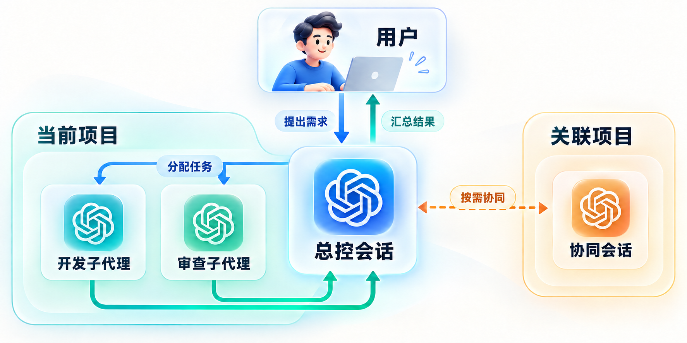

<div align="center">

# 牛马集群

**一个总控会话，协调开发、审查与跨项目协作。**

为 Codex 准备的协作 skill，帮助你把目标拆成清晰任务，组织 AI 代理完成工作，并回收结果进行验收。

[工作原理](#工作原理) · [适用场景](#适用场景) · [安装](#安装) · [使用示例](#使用示例)

</div>



## 工作原理

1. **提出目标**：你在当前会话说明想做什么、涉及哪些项目，以及如何验收。
2. **拆分与执行**：总控明确任务边界；适合拆分的开发、修复和审查工作优先考虑交给子代理。独立审查可由未参与实现的子代理承担。
3. **按需跨项目协同**：涉及关联项目的共同开发、联调或测试时，可在对应项目创建协同会话，具体取决于用户授权和当前工具规则。
4. **汇总与验收**：总控检查实际产物、最终差异和验证证据，再向你报告完成情况与未验证部分。

简单任务由总控直接完成。图中的虚线表示跨项目协同按需进行。

## 适用场景

| 你想做什么 | 牛马集群如何协作 |
| --- | --- |
| 开发功能或修复问题 | 按文件所有权和依赖拆分任务，协调子代理执行。 |
| 检查代码质量 | 为适合独立检查的部分安排未参与实现的审查代理。 |
| 联动多个项目 | 明确相关项目、接口和协同边界，按需组织开发、联调或测试。 |

## 安装

将仓库克隆到 Codex 的技能目录：

```bash
git clone https://github.com/howtimeschange/niuma-jiqun.git ~/.codex/skills/niuma-jiqun
```

如果目标目录已存在，请先检查并备份其中的内容，避免覆盖本地修改。安装后重新打开 Codex，或按当前客户端支持的方式刷新技能列表。

## 使用示例

在 Codex 中明确调用 `$niuma-jiqun`，并描述目标、范围和验收标准：

```text
$niuma-jiqun 帮我实现这个功能，并安排独立审查；保留现有无关改动。
```

也可以说明关联项目和需要配合的工作：

```text
$niuma-jiqun 实现当前项目的接口调用，并协调关联项目一起联调和测试。
```

创建新会话、使用子代理和选择模型受当前环境的工具规则与用户授权约束。技能不会自行扩大权限；提交、推送、部署和外部写入仍需相应授权。

## 仓库内容

```text
niuma-jiqun/
├── SKILL.md                  # 技能入口与协作规则
├── agents/openai.yaml        # Codex 界面显示名称
├── assets/collaboration.png  # 协作示意图
└── README.md
```

技能的完整现有文件是 `SKILL.md` 和 `agents/openai.yaml`。README 和图片用于介绍与展示。
